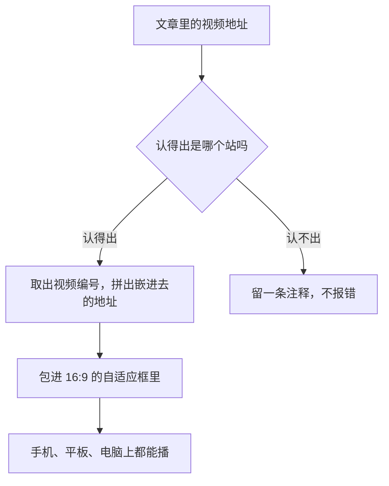

# Smartideo 复刻版

给 WordPress 文章加上在线视频支持的插件：粘贴视频地址就能嵌进来，手机、平板上都是自适应播放。

灵感来自 Fens Liu 的 Smartideo，代码是重新写的。只适用于 WordPress。

## 用法

在文章里写一句短代码，`src` 后面填视频页面的地址：

```
[smartideo src="https://www.youtube.com/watch?v=xxxx"]
[smartideo src="https://www.bilibili.com/video/BVxxxx"]
[smartideo src="https://vimeo.com/123456789"]
[smartideo src="https://v.youku.com/v_show/id_Xxxxx.html"]
[smartideo src="https://v.qq.com/x/cover/abc/def.html"]
[smartideo src="https://example.com/video.mp4"]
```

也可以直接把视频地址单独放一行，不用写短代码，插件会自动转成播放器。

还支持直接给嵌进去的地址（哪个站的嵌法都行）：

```
[smartideo embed="https://player.bilibili.com/player.html?bvid=BVxxxx"]
```

短代码还能加参数：

| 参数 | 意思 | 默认 |
| --- | --- | --- |
| `src` | 视频页面的地址 | 无 |
| `embed` | 直接给嵌进去的地址 | 无 |
| `width` | 播放器最宽多少像素 | 640 |
| `autoplay` | `1` 是自动播放 | `0` |
| `ratio` | 比例，`16:9` 或 `4:3` | `16:9` |

## 支持的平台

| 平台 | 认得的地址样子 |
| --- | --- |
| YouTube | `youtube.com/watch?v=…`、`youtu.be/…`、`youtube.com/shorts/…` |
| Vimeo | `vimeo.com/…` |
| 哔哩哔哩 | `bilibili.com/video/BV…`、`bilibili.com/video/av…` |
| 优酷 | `youku.com/v_show/id_….html` |
| 腾讯视频 | `v.qq.com/x/cover/…/….html`、`v.qq.com/x/page/….html` |
| 直链 | `.mp4`、`.webm`、`.ogv` 结尾的地址，用浏览器自带的播放器 |

## 工作原理



- 短代码 `[smartideo]`：按 `src` 或 `embed` 生成播放器。
- 自动嵌视频：文章里单独成行的视频地址，在 WordPress 自带嵌法之前先转成播放器，统一成自适应框，不会重复嵌两次。
- 样式直接写在标签上：不用等主题加载样式，放到哪儿都能播。
- 各站的嵌法都是各站自己提供的，播不了一般是对方改了嵌法或限制了外站播放。

## 安装

1. 把 `ayan-smartideo` 文件夹上传到 `wp-content/plugins/`，或者在后台 插件 → 安装插件 → 上传插件，选择压缩包。
2. 在插件列表里启用 Smartideo 复刻版。
3. 默认宽度、自动播放这些在 设置 → Smartideo 里改。

## 反馈

有问题或建议，去仓库提 Issue：https://github.com/JUYIKEJI/wordpress-smartideo/issues

## 相关链接

- [阿彦的主页](https://github.com/JUYIKEJI)
- [网站地图插件（WordPress 版）](https://github.com/JUYIKEJI/wordpress-sitemap)（1.0.0 版）
- [网站地图插件（Typecho 版）](https://github.com/JUYIKEJI/sitemap)（1.2.0 版）
